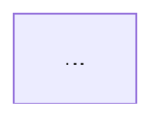

# Orchestration Planning

This skill describes how to create an execution topology in order to maximize parallism, with minimal coordination and no write conflicts.

## Requires

You receive one or more requested outcomes.

For each, use available information about:

- desired end state
- reason/change motivation
- affected systems or likely scope
- constraints
- known files when available

## Principles

- [Parallelize uncertainty; serialize dependency](references/principles/uncertainty-parallization.md)
- [Divide by task groups, subdivide by tasks](references/principles/dividing-method.md)
- [Use worktrees in order to avoid write conflicts](references/principles/worktree-usage.md)

## Tags

Annotate each workstream or step with applicable tags:

- `[AGENT: \`name\`]`
- `[SKILL: \`name\`]`
- `[MCP: \`name\`]`
- `[PARALLEL]`
- `[OWNER: \`workstream-id\`]`
- `[COUPLING: \`INDEPENDENT|LOOSE|TIGHT\`]`
- `[READ-ONLY]`
- `[MUTATING]`
- `[VALIDATE: \`oracle\`]`
- `[REPLAN: \`condition\`]`

## Output

Return exactly four sections.

### 1. Orchestration directives

Concise instructions for orchestrator:

- ownership strategy
- safe parallelism
- sequential dependencies
- approval boundary
- replanning triggers

### 2. Workstreams

For each workstream include:

- ID
- outcome
- agent
- lifecycle (`SCOUT`, `WORKSTREAM_OWNER`, `REVIEWER`, `ORCHESTRATOR`)
- coupling
- write ownership
- dependencies
- skills/MCPs
- validation oracle
- completion condition

### 3. Execution waves

Describe dependency waves, not clock-time estimates.

Example:

- Wave 0: parallel read-only discovery
- Gate A: resolve scope/interface
- Wave 1: independent implementation owners
- Gate B: owner validation
- Wave 2: independent reviewers
- Gate C: findings triage
- Wave 3: original owners repair
- Gate D: affected re-validation

Skip unnecessary waves.

### 4. Mermaid

Produce valid Mermaid:

Show:

- workstream ownership
- parallel branches
- dependency gates
- review paths
- repair returning to original owner
- replanning points where material
